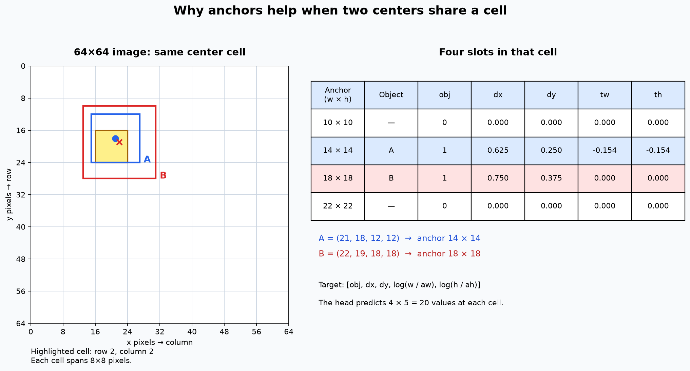

# Exam guide: multi-object detection with anchors

This guide explains the implementation in this repository, not every possible anchor detector. Read it alongside `src/anchors.py`, `src/multi_dataset.py`, `src/detection_metrics.py`, and `src/compare_anchors.py`. The actual numbers from the reproducible experiment are in [EXPERIMENT_REPORT.md](EXPERIMENT_REPORT.md).

## 1. The 60-second explanation

> The original CNN produces one candidate box per grid cell, but its original inference returns only the best box in the whole image. Our images can contain two to four overlapping objects. I kept the original backbone and added a head with four anchor slots per cell. Each slot predicts an objectness score, a center offset, and a width/height adjustment relative to its anchor. We assign ground-truth boxes to free anchors in the cell containing each center, train objectness and box regression, then decode and apply NMS. We evaluate all predicted boxes by one-to-one IoU matching against all ground truths. We compare the unchanged original behavior, a one-anchor-per-cell control, and four anchors on the same images.

Important qualification: **anchors make multiple objects in the same cell representable; they do not guarantee that every overlapping or occluded object can be detected.** The model is class-agnostic: it localizes objects but does not identify circle versus square versus triangle.

## 2. Which files matter?

| File | Role |
|---|---|
| `src/dataset_generator_3.py` | Draws 2–4 nearby/overlapping shapes and creates one `cx cy w h` label per object. Its broken argument order was fixed; a CLI and optional test split were added. |
| `src/multi_dataset.py` | Parses all annotation lines, converts boxes to corners for evaluation, constructs targets for all three models, and batches variable-length annotations. |
| `src/detector.py` | Original `Detector`, single-object `code`, `compute_loss`, `decode`, IoU, NMS, and original top-one `predict`. This is the baseline. |
| `src/anchors.py` | Anchor sizes, target assignment, anchor head, anchor loss, box decoding, and multi-box inference. |
| `src/anchor_diagram.py` | Regenerates the same-cell assignment diagram from the actual encoder. |
| `src/detection_metrics.py` | One-to-one matching, precision, recall, F1, and 101-point AP at IoU 0.5. |
| `src/compare_anchors.py` | Builds identical train/validation/test splits, trains all three models, selects thresholds on validation, evaluates the held-out test split, and saves figures, numbers, and checkpoints. |
| `src/infer_anchors.py` | Loads a saved checkpoint and predicts on one image. |
| `src/train.py` | Original training/evaluation functions. The reported epoch loss was corrected to weight batches by their size; the optimization itself is unchanged. |
| `notebooks/demo.ipynb` | Original single-object notebook; it now uses the compatible single-object generator. Old, inconsistent outputs were cleared. |
| `notebooks/anchors_demo.ipynb` | Interactive walkthrough of assignment, saved comparison, and inference. |
| `tests/` | Executable checks for collisions, encode/decode, NMS, metrics, data, and the end-to-end path. |

The other generators are **not** the multi-object training source. `dataset_generator.py` produces one object and four numbers. Although its old docstring says normalized coordinates, its actual labels are in pixels. `dataset_generator_2.py` produces one object plus a fifth class ID, which the original four-value `ShapeDataset` cannot read directly; this project does not train a class-prediction head. `dataset_generator_3.py` is the intended multi-object generator.

## 3. The data and why cell collisions matter

An example annotation file can contain:

```text
21.0 18.0 12 12
22.0 19.0 18 18
```

Each row is an entire bounding box in **pixels**: `(center_x, center_y, width, height)`. These are not YOLO-normalized values and there is no class ID. Box corners are `(cx-w/2, cy-h/2, cx+w/2, cy+h/2)`.

For a 64×64 image and stride 8, the feature map is 8×8. A cell represents an 8×8 region of possible **centers**, not an 8×8 limit on box size. In the example, both centers fall in row 2, column 2. A single cell slot cannot store both ground truths at once. Four slots can represent up to four centers in that same cell. The experiment records how many labels each target encoder has to drop.

`make_example` places each subsequent figure near the previous one, so collisions are common. It draws all figures in annotation order; later figures can hide earlier ones. The annotation remains the **full original box**, even if most or all of a shape is hidden. A completely hidden shape can be impossible to infer uniquely from the pixels. The supplied experiment uses 2–4 red circles. Optionally, `--shape mixed` chooses circles, squares and triangles independently within an image, but the labels still do not include class IDs; train a separate model for that setting. A separate mixed-geometry run is included, but neither run evaluates blank images or real photographs.

The **original model** has a five-value output at every cell, but the supplied `predict` function returns just **one box for the entire image**. For a fair, explicit adaptation to multi-object images, the baseline trains on the **last drawn** label, which is not covered by any later shape, and is evaluated against *all* ground-truth objects. If a test set has `N` images and `M` objects, this original predictor can match at most `N` objects: its recall cannot exceed `N/M` even if every predicted box is correct.

The **one-anchor control** has one slot per cell but returns multiple detections from different cells. When several centers share a cell it retains the most recently drawn box there. The **four-anchor model** uses four slots per cell and tries to assign all boxes. This control is important: multi-object detection is possible across different cells even with only one slot per cell. The extra slots help specifically with same-cell collisions; they are not the only reason the original top-one baseline improves.

## 4. Backbone, head, and tensor dimensions

The original and both anchor models share the same backbone architecture:

```text
input                (B,  3, 64, 64)
conv 3×3, stride 2   (B,  8, 32, 32)  + batch norm + ReLU
conv 3×3, stride 2   (B, 16, 16, 16)  + batch norm + ReLU
conv 3×3, stride 2   (B, 32,  8,  8)  + batch norm + ReLU
```

The stride is `2 × 2 × 2 = 8`. With `A` anchors and one class-agnostic objectness score, the 1×1 head outputs `5*A` channels:

```text
original head:       (B,  5, 8, 8)
one-anchor head:     (B,  5, 8, 8) -> (B, 1, 8, 8, 5)
four-anchor head:    (B, 20, 8, 8) -> (B, 4, 8, 8, 5)
```

`AnchorDetector.forward` reshapes and permutes the head output into the last layout. Its last dimension is:

```text
[objectness_logit, tx, ty, tw, th]
```

There are `8 × 8 × 4 = 256` anchor/cell candidates per 64×64 image before filtering. An anchor is a **prior width and height**, not a fixed final rectangle and not a class. At size 64 the four priors are `(10,10)`, `(14,14)`, `(18,18)`, `(22,22)` pixels, selected to cover the generator's square box sides of 10–21 pixels. For another supported size they are scaled proportionally. All priors are square because this generator's boxes are square; a real dataset might need varied aspect ratios, data-driven clustering, more scales, and additional feature-map levels.

## 5. Assignment of ground truths to anchors

`encode_targets(boxes, anchors, size)` returns `(target, dropped_count)`. `target` has shape `(A, G, G, 5)` and is initially all zeros.

For each ground-truth box, in annotation order:

1. Divide its center coordinates by `STRIDE=8`. Integer parts select `(column, row)`; fractional parts become `dx, dy`.
2. Compare its width and height with each anchor's width and height. These comparisons pretend both boxes have the same center; this is **shape IoU**, not full image-space IoU.
3. Sort anchors by shape IoU, best first; choose the highest-ranked **free** anchor in that cell. A second object in the cell falls back to another available anchor rather than overwriting the first.
4. Store `[1, dx, dy, log(w/anchor_w), log(h/anchor_h)]` in that slot. Its objectness target is 1. Other slots remain negative with objectness target 0.
5. If every slot in the center cell is occupied, increment `dropped_count`. Do not silently overwrite a target.

With the default 2–4 objects and four anchors, no more than four objects can fall in any cell, so no ground-truth assignment needs to be dropped. If the generator is configured for more objects or the anchor count is reduced, overflow is possible. This assignment is greedy and depends on label order; it is not a globally optimal matching algorithm.

### Worked numerical example



Use a 64×64 image, stride 8, and ground truth A = `(21, 18, 12, 12)`:

- `gx = 21/8 = 2.625`, `gy = 18/8 = 2.25`.
- Column = 2, row = 2; `dx = 0.625`, `dy = 0.25`.
- Shape IoU with 10×10 = `100 / 144 ≈ 0.694`.
- Shape IoU with 14×14 = `144 / 196 ≈ 0.735`; this is the best of the four priors.
- The slot for anchor 14×14 at row 2, column 2 stores approximately `[1, 0.625, 0.25, -0.154, -0.154]`, because `ln(12/14) ≈ -0.154`.

For B = `(22, 19, 18, 18)`, the center is also in row 2, column 2, with offsets `(0.75, 0.375)`. Its best anchor is 18×18, so a second slot stores `[1, 0.75, 0.375, 0, 0]`. Both objects now have targets in the **same cell**. If two objects both prefer the 14×14 prior, the second chooses the best remaining free prior. The network can adjust it back to the actual width/height using the log-size targets.

## 6. From raw network output to boxes

For cell `(row, col)`, anchor `(aw, ah)`, and raw outputs `(o, tx, ty, tw, th)`:

```text
score = sigmoid(o)
cx = (col + sigmoid(tx)) * stride
cy = (row + sigmoid(ty)) * stride
w  = aw * exp(clamp(tw, -4, 4))
h  = ah * exp(clamp(th, -4, 4))
x1, y1, x2, y2 = cx-w/2, cy-h/2, cx+w/2, cy+h/2
```

The final corners are clipped to the image. Sigmoid constrains each center offset to `(0,1)`; exponential makes dimensions positive and allows them to differ from the prior. The clamp prevents numerical overflow on extreme logits. The target stores the inverse transform, `log(w/aw)` and `log(h/ah)`. A target offset can equal zero; a finite sigmoid only approaches the exact cell boundary, so test round trips use a very small numerical tolerance.

Example: to reconstruct A above, the network could output `tx = log(0.625/0.375) ≈ 0.511`, `ty = log(0.25/0.75) ≈ -1.099`, and `tw=th≈-0.154`. Decoding gives approximately `(21,18,12,12)`, or corners `(15,12,27,24)`.

## 7. Loss and optimization

`anchor_loss` is:

```text
L = BCEWithLogits(objectness, objectness_target; positive_weight=10)
    + 10 * MSE(sigmoid(predicted_xy), target_xy)          [positive slots only]
    +  2 * SmoothL1(predicted_log_wh, target_log_wh)     [positive slots only]
```

- Objectness BCE trains every slot, including empty cells. A positive weight of 10 compensates partly for many negative slots; it is a chosen hyperparameter, not a guarantee of calibrated probabilities.
- Center loss applies only where an object was assigned. The sigmoid center and target offset are both in `[0,1]`.
- Size loss also applies only to assigned slots. The raw `tw,th` are compared with target log ratios; applying sigmoid here would be incorrect because log ratios may be negative or larger than one.
- `SmoothL1` is quadratic near zero and linear for larger errors; it is less sensitive to large residuals than plain squared error.
- An entirely empty target batch produces finite objectness loss. The comparison dataset itself always has at least one object per image.

For each batch: `model.train()`, clear gradients, forward pass, calculate loss, `loss.backward()`, then `optimizer.step()`. The experiment uses Adam and the same epoch count, learning rate, batch size, image order, and initial backbone seed for all three models. The models have different objectives and targets, so **do not compare their training loss numbers as if they meant the same thing**. Epoch losses are accumulated with batch-size weighting; the original `src/train.py` had divided a sum of batch means by the number of images without this weighting, so its old printed values were too small.

At evaluation, `model.eval()` makes batch normalization use running statistics, and `torch.no_grad()` prevents gradient tracking. Training and evaluation must use the same preprocessing (`RGB`, float tensor, divide by 255) and image size.

## 8. Scores, NMS, and their trade-offs

`predict_anchors` first decodes all slots, keeps scores at least 0.01, takes at most the highest-scoring 100, applies non-maximum suppression, then keeps at most 20 boxes. These settings define the candidate set used for AP. The experiment uses NMS IoU 0.60 for **both** anchor controls; it was chosen using development experiments, not the final test set. The operating confidence threshold is selected separately for each model using validation F1.

NMS repeatedly keeps the highest-score remaining box and removes boxes whose IoU with it is **at least** the NMS threshold. For boxes `[0,0,10,10]` and `[1,1,11,11]`, the overlap is 9×9 and IoU is `81/(100+100-81) ≈ 0.681`. At NMS 0.60, the lower-scored box is removed.

NMS is useful for duplicate predictions, but two *different* ground-truth objects can also overlap by more than 0.60. NMS may incorrectly remove a true object. Increasing the threshold preserves more overlaps but also leaves more duplicates; Soft-NMS, instance segmentation, or another matching/postprocessing strategy may help. NMS has no knowledge of the ground truth. The original code's default NMS threshold is 1.1, which effectively suppresses nothing; original `predict` nevertheless returns the highest-scoring single box. The new multi-object path explicitly supplies its NMS threshold.

Do not confuse these three thresholds:

1. **Candidate score** 0.01: discards extremely low-score anchor candidates before NMS/AP.
2. **NMS IoU** 0.60: compares *prediction against prediction* to suppress duplicates.
3. **Matching IoU** 0.50: compares *prediction against ground truth* to count a true positive.

The selected **operating confidence** is a fourth number: validation chooses it for each model, and the test metrics use that fixed value.

## 9. How detection metrics are calculated

`evaluate_detections` sorts supplied predictions across the dataset by descending confidence. For each prediction, it considers only ground truths from the **same image** and matches the unmatched one with maximum IoU, if that IoU is at least 0.5. A ground truth cannot be matched twice. Therefore a duplicate prediction is a false positive even when it overlaps an already-matched object.

```text
TP = predictions matched to distinct ground truths at IoU ≥ 0.5
FP = retained predictions with no valid unmatched ground truth
FN = ground truths that were not matched
precision = TP / (TP + FP)
recall    = TP / (TP + FN)
F1        = 2 * precision * recall / (precision + recall)
```

Mean IoU in the report is the **mean over true-positive matches only**; it is not the mean over all objects and must be read with recall. Zero denominators are handled as zero, not NaN.

For AP@0.5, vary the score cut through the entire supplied ranked candidate list. Compute the precision/recall curve and, for each of the 101 recall levels `0.00, 0.01, ..., 1.00`, take the highest precision at or above that recall; average these 101 values. AP uses the candidate list, not the validation-selected operating threshold. It is **single-class AP at IoU 0.5**, not COCO mAP averaged across classes and IoU thresholds. It is affected by the candidate cutoff, pre-NMS cap, NMS threshold, and maximum detections. The original model supplies only one candidate per image.

Example with two ground truths and ranked outcomes `[TP, FP, TP]`: at the end `precision=2/3`, `recall=1`, and `F1=0.8`. The 101-point AP is approximately `(51×1 + 50×(2/3))/101 ≈ 0.835`, not simply the final precision.

`choose_threshold` considers 0.05–0.95 in steps of 0.05 plus 0.96, 0.97, 0.98, 0.99, 0.995 and 0.999. It maximizes validation F1, breaking ties in favor of the higher threshold. The selected threshold is then frozen for the held-out test set. AP does not change when this operating threshold changes.

## 10. Experiment design and interpretation

Default reproducible experiment: 1,200 training, 200 validation and 200 test images, generated using separate seeds 42, 43 and 44. The script rejects identical input images appearing in different splits. Development runs used separate seeds; model choices were not made from the final test set. All models see the same images and number of epochs and use the same initial backbone seed and optimizer settings. They do **not** have identical training labels, parameter counts, box parameterizations, or inference limits:

| Model | Training target | Predictions permitted | Parameters |
|---|---|---|---:|
| Original | Last-drawn box only | At most 1 per image | 6,309 |
| One-anchor control | Up to 1 box per center cell | Multiple per image | 6,309 |
| Four anchors | Up to 4 boxes per center cell | Multiple per image | 6,804 |

The original uses its original loss and size parameterization. Both anchor controls use the same new loss, decoder, NMS and matching procedure, but have different anchor priors and slot counts. All three use the same test ground truths and metric definition. The comparison shows the behavior of these complete configurations; it is **not** proof that anchor count alone caused every difference. The one-anchor control narrows the comparison, but capacity, prior sizes, assignment, and visibility still matter. Original precision can be high while recall is low because it makes only one conservative prediction per image.

A second experiment trains separate models on mixed circles, squares and triangles, with seeds 142/143/144; the task remains class-agnostic. In that test, four anchors achieved higher AP@0.5 than one anchor but lower recall and F1 at the validation-selected thresholds. This illustrates why more anchors do not guarantee a win on every metric. See [EXPERIMENT_REPORT.md](EXPERIMENT_REPORT.md) for both tables.

The fixed test figures show the **first** test images, not a hand-picked set of successes. See `results/anchor_comparison/metrics.json` for counts and scores and `results/anchor_comparison/examples.json` for the exact boxes behind the figure; the mixed run uses `results/mixed_shape_comparison/`. The supplied checkpoints are small and can be used with `src.infer_anchors`; results depend on the training data and should not be assumed to generalize beyond it.

## 11. Code walkthrough by function

### `src/dataset_generator_3.py`

- `draw_shape(draw, shape, box)` renders an ellipse, rectangle, or triangle with a common color and outline; it rejects an unknown shape.
- `make_example(size, shape, rng, min_objects, max_objects)` samples a light background, object count, sizes, and positions. The first position is random; later centers are jittered around the previous one and clipped to the canvas. It draws in label order and returns a PIL image plus newline-separated pixel labels. Its default is exactly two objects; the comparison explicitly requests two to four. If `shape="mixed"`, the geometry is sampled independently per object, but no class ID is stored.
- `generate(...)` writes matching numbered PNG/TXT pairs under `train`, `val`, and optional `test`. It now calls `make_example(size, shape, rng, min_objects=..., max_objects=...)` in the right order. It uses one RNG sequentially across the splits; the in-memory comparison instead uses separate split seeds, so the same numeric seed does not make those two workflows identical. Use a fresh output directory: older extra numbered files are not deleted.
- `main()` exposes generation as `python -m src.dataset_generator_3 ...`.

### `src/multi_dataset.py`

- `parse_labels` checks each nonempty line contains exactly four numeric values and returns an `(N,4)` tensor.
- `xywh_to_xyxy` subtracts/adds half the size to the center; evaluation expects corners.
- `MultiShapeDataset` normalizes each RGB image to a `3×H×W` float tensor, keeps **all** ground-truth boxes, and constructs the original, one-anchor and four-anchor targets. Its stats count shared-cell images and dropped assignments. For one anchor it reverses drawing order to prefer the more visible last-drawn object in a collision; for four anchors it uses normal annotation order.
- `from_generator` creates samples in memory from a seeded RNG. `from_folder` reads PNGs and their matching TXT files. `collate_multi` stacks same-sized images and fixed-size target tensors but leaves variable-length ground-truth boxes as a list.

### `src/anchors.py`

- `default_anchors(size)` returns four square pixel priors, scaled with the image size.
- `_check_anchors` validates that there is at least one finite, positive `(w,h)` prior.
- `encode_targets` assigns objects to slots as described above and counts overflow.
- `AnchorDetector` inherits the original backbone, registers anchors as a buffer (they travel with `.to(device)` and the checkpoint but are not trainable parameters), replaces the head with `5*A` channels, and starts objectness biases at -2. `forward` validates input size and returns `(B,A,G,G,5)`.
- `anchor_loss` computes the weighted objectness, center, and size losses; negatives never contribute box regression.
- `decode_anchors` reverses the targets' parameterization and returns `(A*G*G,4)` corners plus one score per candidate.
- `predict_anchors` applies confidence filtering, a top-k cap, NMS, and a maximum-output cap. It can return zero boxes.

`src/anchor_diagram.py` constructs the two numerical example boxes, calls the actual `encode_targets`, then draws the image grid and slot table. Regenerate its illustration with `python -m src.anchor_diagram`.

### `src/detection_metrics.py`

- `_rank_and_match` sorts predictions by score, enforces image boundaries and one-to-one matches, and records TP flags and matched IoUs.
- `_average_precision` computes the 101-point interpolated AP from the ranked list.
- `_summary` computes counts, P/R/F1, and mean IoU at one operating threshold.
- `evaluate_detections` combines those steps; `choose_threshold` reuses the ranked matches to select a validation threshold without repeatedly doing matching.

### The original detector in detail

The baseline's `ShapeDataset.__getitem__` reads exactly **four** numbers from a TXT file, converts the corresponding image to a normalized RGB tensor, and calls `code(cx,cy,w,h)`. It therefore cannot directly parse generator 3's multi-line files. Our `MultiShapeDataset` adapts the data explicitly instead of pretending otherwise.

`code` creates `(5,G,G)` zeros, finds the cell containing the one center, and fills that cell with `[1, dx, dy, w/size, h/size]`. In the original `Detector`, the five logits per cell are objectness, `dx`, `dy`, relative image width and relative image height. `compute_loss` uses weighted objectness BCE over all cells plus `10 × MSE` on the sigmoid box values in the positive cell. The original loss assumes that at least one positive exists; unlike the new loss, it does not explicitly handle an entirely empty target batch.

Original `decode` applies sigmoid, reconstructs a center from the cell plus offsets, and multiplies normalized widths/heights by image size. Original `predict` decodes all cells, runs the original NMS and returns only the first, highest-scoring box. Its NMS default of 1.1 is ineffective, but even an effective NMS would still return only the first box in that function. In this work its meshgrid and BCE positive-weight tensor were moved to the logits' device; this is a device-compatibility fix, not a new detection algorithm.

The original `train` helper switches to training mode, runs the model, loss, backward pass and optimizer step, and reports the image-count-weighted average of batch mean losses. `evaluate` switches to evaluation mode, reconstructs the single target box and reports mean IoU and the fraction above 0.5. That original metric is not a multi-object metric. `visualize.py` contains helpers for image grids, backbone feature maps and one predicted box per image. The anchor comparison uses a new visualization capable of drawing multiple boxes.

For an oral calculation, the backbone has 6,144 trainable parameters: convolution and batch-normalization blocks contribute 240, 1,200, and 4,704 respectively. The original/one-anchor head adds `32×5+5=165`, giving 6,309; the four-anchor head adds `32×20+20=660`, giving 6,804. The three 3×3 stride-2 convolutions produce an 8-pixel effective stride and a 15×15 convolutional receptive field for a final cell (near edges, some positions are padding). In evaluation, batch normalization uses fixed running statistics; during training it also couples activations through batch/spatial statistics. The small convolutional receptive field is another reason difficult occlusions and larger objects can challenge the model.

All non-assigned anchor slots are treated as objectness negatives, including other anchors at a cell that contains an assigned object. Some larger detectors use an ignore region for high-overlap unassigned anchors; this implementation does not. Four anchors also create more negative slots than one anchor, even though the positive BCE weight is the same. That difference is part of the experiment's limitations and may affect optimization.

### `src/compare_anchors.py` and `src/infer_anchors.py`

- `verify_disjoint_images` rejects identical input pixels appearing in different splits. Separate seeds alone do not logically guarantee uniqueness.
- `build_model` selects the original or one/four-anchor model. `train_one_model` resets seeds, builds the same shuffled order, and trains with Adam for the specified epochs.
- `collect_predictions` calls the original one-box `predict` for the baseline or `predict_anchors` for the controls; it collects CPU predictions and all ground truths.
- `main` creates/loads data, trains each model, selects its threshold on validation, evaluates on test, and writes the three checkpoints, metrics, numeric examples, and PNGs.
- `load_checkpoint` reconstructs the correct network from its saved model kind and anchor list. `detect_image` normalizes a correctly sized image and predicts; the CLI saves an enlarged annotated PNG and a JSON file with **original pixel coordinates**. Load only trusted checkpoints.

## 12. Frequently asked oral-exam questions

1. **What problem are you solving?** Localizing multiple overlapping synthetic shapes in one image, including centers in the same feature-map cell.
2. **What was the initial limitation?** Its target represented one object per image and `predict` returned only the best box, although the head produced one candidate per cell.
3. **Why choose generator 3?** It supplies several nearby/overlapping objects and one box annotation per object. Generators 1 and 2 each supply only one object.
4. **Are the annotations normalized?** No: `cx, cy, w, h` are pixels. The network targets contain cell offsets and anchor-relative log sizes.
5. **Do you recognize classes?** No. All objects are one detection class; even if the generator's optional mixed mode draws different geometries, there is no class head, class loss, or class ID in generator 3's labels.
6. **What is an anchor?** A predefined width/height prior associated with a prediction slot at each cell; regression adjusts it.
7. **How many anchors and why?** Four, 10/14/18/22 pixels at size 64, to cover the generator's 10–21-pixel side range and permit up to four same-cell assignments. They are hand-selected, not learned.
8. **Can one anchor detect multiple objects?** Yes, if they are represented in different cells. One anchor cannot encode two separate ground truths in the same cell at the same time.
9. **How many candidates exist before filtering?** `8×8×4=256` for one 64×64 image.
10. **What are the output tensor dimensions?** Head `(B,20,8,8)`; reshaped to `(B,4,8,8,5)`.
11. **Why five outputs, not eight?** There are five class-agnostic quantities: objectness, two center offsets, and two size adjustments. Adding three class logits would require a different head, labels and loss.
12. **How is a cell chosen?** Divide the box center by stride 8 and take integer column/row parts.
13. **How is an anchor chosen?** Compute center-aligned width/height IoU; take the best available anchor in the selected cell, with deterministic fallback.
14. **What if two objects want the same anchor?** The later processed one takes the next-best free anchor in that cell. No occupied target is overwritten.
15. **What if five centers share a cell?** Four are encoded and one is counted as dropped, given A=4. Assignment is greedy and order-dependent.
16. **What is an anchor's IoU during assignment?** Shape IoU after aligning centers, which measures how well width and height fit; it is not NMS IoU.
17. **Why sigmoid for center offsets?** To keep the predicted center inside the responsible cell.
18. **Why exponential for size?** It makes sizes positive and allows sizes to be scaled above or below the prior. The corresponding target is a log ratio.
19. **Why clamp log sizes?** To prevent `exp` overflow during decoding of extreme predictions.
20. **How do you convert to corner coordinates?** Subtract/add half the predicted width and height from the center, then clip to the image.
21. **What is objectness?** A learned score for whether a slot is responsible for an object; it is not a predicted class label and is not necessarily calibrated.
22. **Why weighted BCE?** Most slots are empty; a positive weight makes positive errors more influential. It is a tunable compromise.
23. **Where is box loss computed?** Only on positive assigned slots. Regressing arbitrary background boxes would be meaningless.
24. **Why does the objectness bias start at -2?** It starts the objectness probability around `sigmoid(-2)≈0.119`, reflecting that most slots are background.
25. **What is the difference between BCEWithLogits and sigmoid followed by BCE?** BCEWithLogits combines both in a numerically stable operation; do not sigmoid objectness first during training.
26. **What does `loss.backward()` do?** It computes gradients of model parameters via the chain rule; Adam then uses those gradients to update parameters.
27. **Why `optimizer.zero_grad()`?** PyTorch otherwise accumulates gradients from previous batches.
28. **Why `model.eval()` and `no_grad()`?** Evaluation uses batch-norm running statistics and avoids recording gradient computations.
29. **What is IoU?** Intersection area divided by union area of two boxes, between 0 and 1 for valid boxes.
30. **What is NMS?** Keep highest-confidence boxes while suppressing lower-confidence boxes that overlap too much with kept boxes.
31. **Can NMS remove a real object?** Yes, especially here because true boxes overlap heavily. The NMS threshold is a trade-off.
32. **What are TP, FP and FN?** Respectively a prediction matched to a distinct ground truth, an unmatched prediction, and an unmatched ground truth.
33. **Why one-to-one matching?** Without it, many duplicate predictions could all receive credit for the same object and falsely inflate recall/precision.
34. **Why is precision not enough?** The original model can make one very accurate prediction per image while missing most objects; its recall exposes that limitation.
35. **What is AP@0.5?** Area-like 101-point interpolated precision/recall summary for one class and IoU matching threshold 0.5, using the supplied candidate set.
36. **Is AP@0.5 the same as COCO mAP?** No. COCO mAP averages over multiple classes and IoU thresholds; this is single-class AP at one IoU.
37. **Why a validation set?** To choose operating confidence without using the test set. The test set estimates performance after choices are fixed.
38. **What prevents a duplicated image crossing splits?** The comparison hashes input tensors and rejects exact duplicates. This is not a guarantee against near-duplicates.
39. **Are the same images used for each model?** Yes, including the same shuffled training order. Their target encodings and model heads differ.
40. **Why include a one-anchor control?** To separate the benefit of returning several detections from the additional ability to encode several centers in one cell.
41. **Why can't this experiment prove anchors always win?** It uses one synthetic generator, limited seeds, a small architecture, different prior sizes and finite training. Results depend on optimization, occlusion, and NMS.
42. **Why might AP improve while F1 worsens?** AP summarizes ranking across confidence thresholds; F1 is a single validation-selected operating point. Precision/recall trade-offs differ.
43. **Is a fully hidden object always detectable?** No. Several different hidden-box configurations can produce the same visible pixels; the target may be inherently ambiguous.
44. **What does `dropped_count` mean?** The number of ground truths that cannot be assigned because all slots in their center cell are already occupied; it is not a count of test false negatives.
45. **What happens on a blank image?** The code can return zero detections, but the generator/experiment has not measured blank-image false positives.
46. **Can I use arbitrary image sizes?** The anchor implementation requires a square image matching the model's configured size, divisible by 8. Priors scale with size; the inference CLI rejects mismatched images.
47. **Why choose square priors?** Generator 3 draws shapes inside square boxes. A dataset with tall/wide boxes needs priors with appropriate aspect ratios or a different detector.
48. **Why does the original model's recall have a ceiling?** It returns at most one prediction per image and each can match at most one truth: maximum recall is number of images divided by total objects.
49. **Does a high confidence mean a guaranteed correct box?** No. Objectness is trained with weighting and can be miscalibrated; the validation threshold is empirical.
50. **Does the comparison use the original loss values as accuracy?** No. Losses are objectives with different scales. Detection metrics on the same held-out annotations are compared.
51. **How would you add classes?** Include class IDs in labels, add class logits per anchor, use a class loss on positives, and perform class-aware evaluation and usually class-aware NMS.
52. **How would you improve same-cell assignment?** Consider a global matching algorithm, richer priors, a finer feature-map stride, multiple feature levels, or an anchor-free/set-prediction design.
53. **How would you make the test stronger?** Use several independent seeds, more samples, blank images, diverse sizes/aspect ratios, stronger occlusion controls, and real-world data; report uncertainty.
54. **Why are the final weights saved?** So the exact trained models can be loaded for inference without retraining; the JSON also stores thresholds and experiment configuration.
55. **What changed in the old notebook?** It now uses the compatible single-object generator, uses a standard Python kernel, accurately describes its sample count, and clears stale outputs. The anchor workflow has its own notebook.

## 13. Short revision checklist

- Draw the 64×64 image, 8×8 grid, and two centers in one cell.
- Derive the output shape `(B,4,8,8,5)` and the 256 candidate count.
- Calculate one shape IoU, select a free anchor, and compute `dx`, `dy`, `log(w/aw)`.
- Decode a predicted slot to `xyxy` and explain objectness, BCE, center MSE and log-size SmoothL1.
- Explain score filtering vs NMS IoU vs ground-truth matching IoU.
- Calculate TP/FP/FN, precision, recall, F1 and the meaning of AP@0.5.
- Explain why original top-one recall is bounded, why the one-anchor control matters, and why four anchors do not guarantee perfect detection.
- Explain train/validation/test separation, exact duplicate checking, occlusion, NMS failure, and the absence of class prediction.
